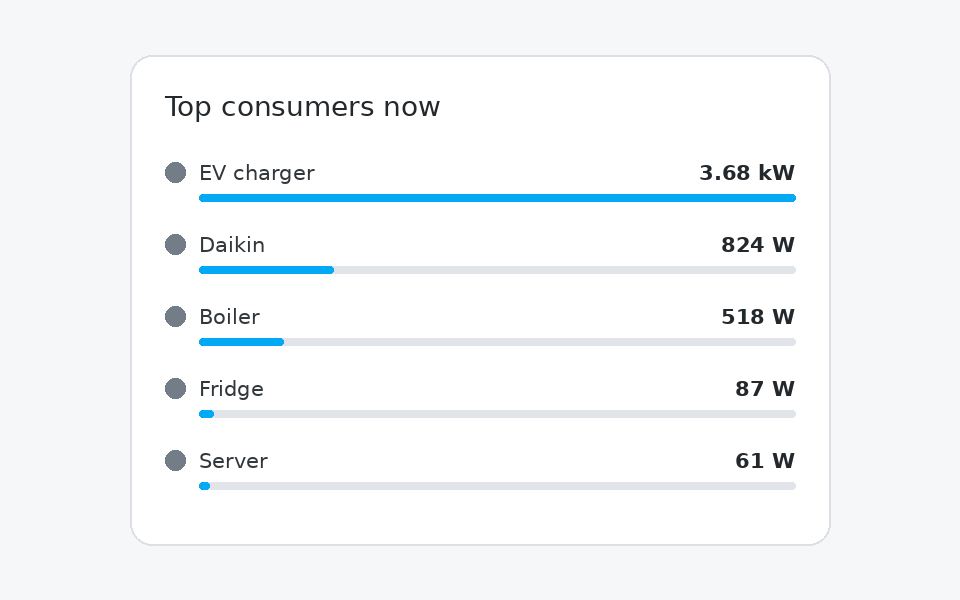

# Energy Consumers Card

A compact Home Assistant dashboard card that automatically ranks **instantaneous power consumption** for the devices already configured under **Settings → Dashboards → Energy → Individual devices**.

No duplicate entity list and no giant exclusion filter: the card reads Home Assistant's Energy configuration and uses each device's configured live power statistic (`stat_rate`).



## Features

- Automatically follows the consumers configured in the Energy dashboard
- Shows live power in W or kW
- Sorts highest consumption first
- Configurable top-N and standby threshold
- Optional relative power bars and ranking numbers
- Uses Energy-dashboard custom names when configured
- Click a row to open the entity's more-info dialog
- No backend integration required

## Installation

### HACS custom repository

Until this card is accepted into the default HACS catalogue:

1. Open HACS in Home Assistant.
2. Open the menu and choose **Custom repositories**.
3. Add this GitHub repository URL and select **Dashboard** as the category.
4. Download **Energy Consumers Card**.
5. Refresh the browser if Home Assistant asks you to.

HACS should register the frontend resource automatically. If not, add `/hacsfiles/energy-consumers-card/energy-consumers-card.js` as a JavaScript module under dashboard resources.

### Manual

Copy `dist/energy-consumers-card.js` to `/config/www/energy-consumers-card.js`, add `/local/energy-consumers-card.js` as a JavaScript module resource, then refresh the browser.

## Basic card

```yaml
type: custom:energy-consumers-card
```

## Example

```yaml
type: custom:energy-consumers-card
title: Top consumers now
count: 6
min_power: 5
show_bar: true
show_rank: false
unit: auto
```

## Options

| Option | Default | Description |
| --- | --- | --- |
| `title` | `Top consumers now` | Card title. Set to an empty string to hide it. |
| `count` | `6` | Maximum number of consumers shown. |
| `min_power` | `1` | Hide devices consuming less than this many watts. |
| `show_bar` | `true` | Show a relative power bar below each row. |
| `show_rank` | `false` | Show 1, 2, 3… beside consumers. |
| `unit` | `auto` | `auto`, `W`, or `kW`. |

## How it works

Home Assistant exposes the Energy dashboard preferences through its WebSocket API. Individual consumers can contain both a cumulative energy statistic (`stat_consumption`) and a live power statistic (`stat_rate`). This card reads `energy/get_prefs`, selects `device_consumption[].stat_rate`, resolves those entities from the current Home Assistant state, converts the readings to watts, and ranks them live.

Devices that do not have a live power sensor configured in the Energy dashboard are omitted, because a cumulative kWh statistic cannot provide instantaneous power reliably.

## Compatibility

This card relies on the Energy dashboard's `device_consumption` / `stat_rate` configuration available in current Home Assistant releases. Keep Home Assistant reasonably up to date.

## Development

The source file is under `src/` and the HACS distributable is under `dist/`.

```bash
npm run build
npm run check
```

## License

MIT
